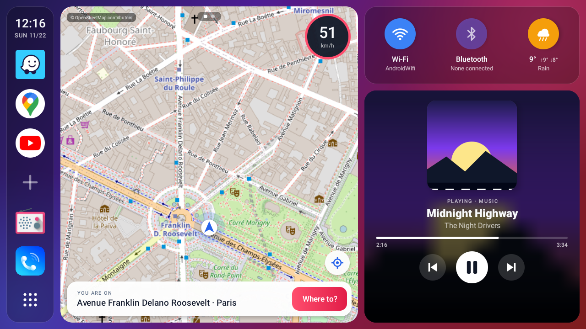
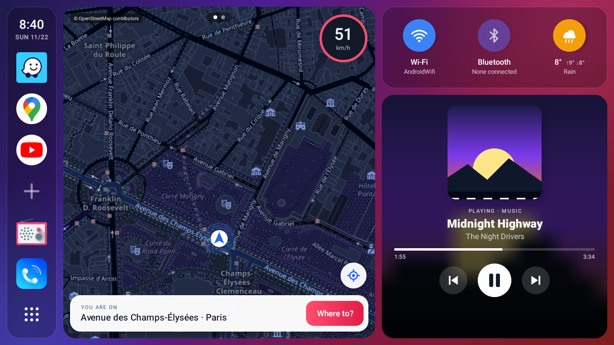
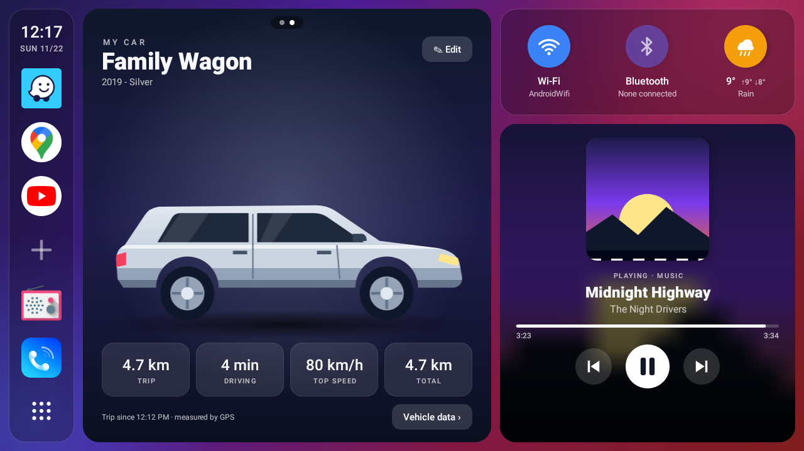
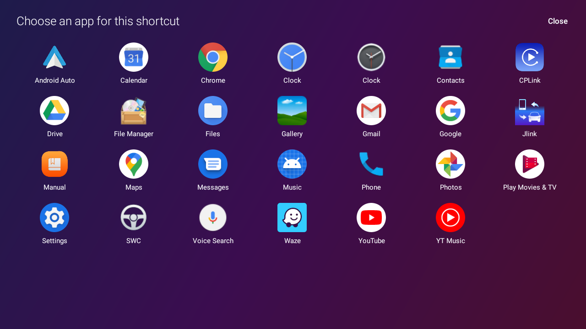
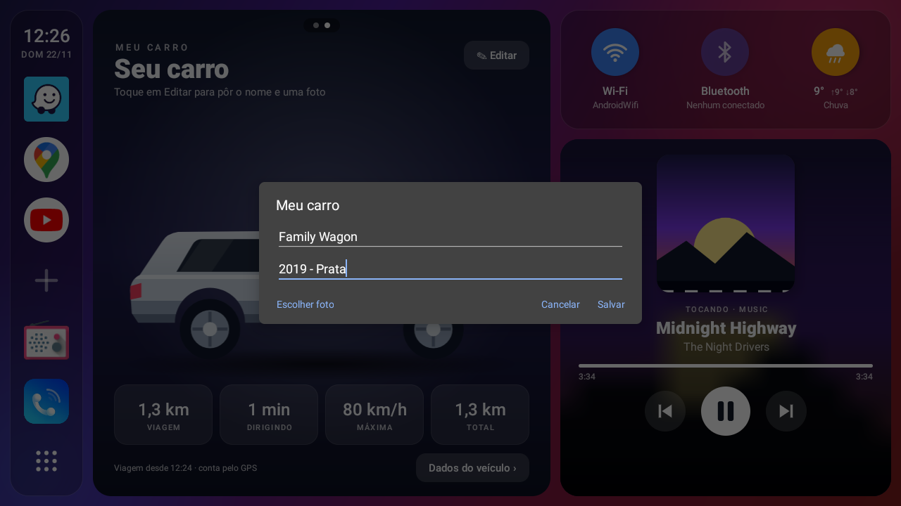
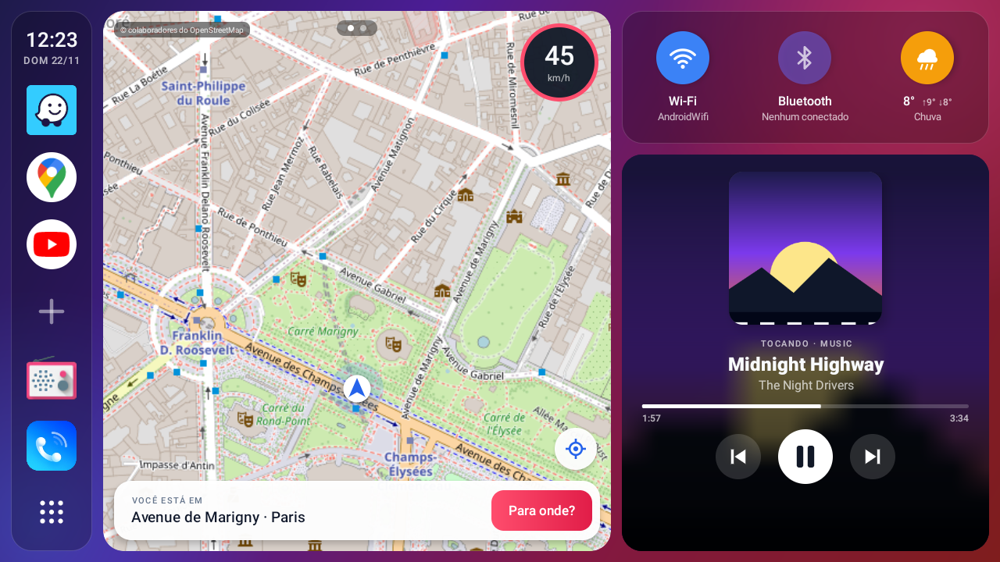

<div align="center">

# Kesh Car

**A fast, free and open-source launcher for Android car head units.**

Map, music, weather and your apps on one screen — built for the cheap 1280×720 Android stereos
that ship with clunky stock launchers.

[](https://github.com/Kesh-2k/kesh-car-launcher/actions/workflows/build.yml)
[](https://github.com/Kesh-2k/kesh-car-launcher/releases/latest)
[](LICENSE)




</div>

## Why

Most aftermarket head units (Jancar, FYT, MTCD, ATOTO-style "Android 13" stereos and friends) come with a
launcher that is slow, cluttered or simply ugly. Kesh Car replaces it with a single, glanceable dashboard:

- **Under 400 KB** (release APK), no Google Play Services, no AndroidX, no Compose — plain Android views drawn in code.
- Starts instantly on a 4-core RK3326 with 1–2 GB of RAM and stays smooth while the map follows the GPS.
- No accounts, no ads, no tracking.

## Features

- **Live map in the middle** — OpenStreetMap that follows your position, heading-up rotation, speed bubble,
  one-tap re-center and an automatic **night mode** from 18:00 to 06:00. The last position is remembered, so the
  map is there the moment the car starts, even before the GPS gets a fix.
- **"You are on …"** — current street and city. Works **offline** with an optional street file for your region
  (see [Offline street names](#offline-street-names)), or online through the system geocoder / Nominatim.
- **Now playing** — artwork, title, progress and controls for any app that publishes a media session (Spotify,
  YouTube Music, Deezer, Pocket Casts, radio apps…). Remembers the last track and can resume it when the car starts.
- **Quick tiles** — Wi-Fi network, connected Bluetooth device and current weather (Open-Meteo, no API key).
- **Sidebar shortcuts** — six slots, long-press to change. Sensible defaults: Waze, Google Maps, YouTube, Spotify,
  and the unit's own radio and phone apps when present (Jancar, FYT/SYU, MTCD), falling back to the stock dialer.
- **"My car" page** — swipe the map sideways to see your car (a clean illustration by default, or your own photo)
  with GPS trip stats: distance, driving time, top speed and total distance.
- **App drawer** with every installed app.
- **Comes back by itself** on Autochips/Jancar units, whose firmware force-closes third-party launchers on power-off.
- **Languages:** English and Brazilian Portuguese (follows the system language). Units are metric (km, km/h, °C).

## Screenshots

| | |
|:-:|:-:|
|  <br> Automatic night mode |  <br> "My car" with GPS trip stats |
|  <br> Long-press a shortcut to change it |  <br> Set your car's name and photo |
|  <br> Português (Brasil) |  <br> Meu carro |

## Requirements

- Android **7.0 (API 24)** or newer. Developed and tested on Android 11 head units (Rockchip RK3326, Jancar
  firmware) — many of those report "Android 13" in Settings.
- Landscape screen; designed for **1280×720 at ~160 dpi**, works on larger screens too.
- A GPS receiver for the map, street name and trip stats (all head units have one).
- Internet (Wi-Fi hotspot from your phone is enough) for map tiles and weather. Tiles you have seen are cached
  (up to 300 MB), so familiar routes keep working offline.

Running it on a unit that is not listed here? Please [open an issue](https://github.com/Kesh-2k/kesh-car-launcher/issues/new/choose)
with the model and Android version, even if everything just works — it helps others pick a head unit.

## Install

1. Download `kesh-car-<version>.apk` from the [latest release](https://github.com/Kesh-2k/kesh-car-launcher/releases/latest)
   and install it (USB stick + the unit's file manager, or `adb install kesh-car-<version>.apk`).
2. Press the Home button and pick **Kesh Car → Always**. If no chooser shows up, look for
   *Settings → Apps → Default apps → Home app* (on some units it is hidden in the vendor settings).
3. Grant the permissions below.

### Permissions and why

| Permission | Why | How |
|---|---|---|
| **Location** | Map position, speed, street name, trip stats and local weather. | Asked on first start (or *Settings → Apps → Kesh Car → Permissions*). |
| **Notification access** | Android only exposes the "now playing" media sessions to apps with notification access. Kesh Car never reads your notifications' content. | Tap the music card ("Tap to allow notification access"), or *Settings → Apps → Special app access → Notification access*. |
| Display over other apps *(optional)* | Lets Kesh Car bring itself back to the front when the unit powers on (needed on Jancar units). | *Settings → Apps → Special app access → Display over other apps*. |

Units without those screens can be set up over ADB:

```sh
P=io.github.kesh2k.keshcar
adb shell pm grant $P android.permission.ACCESS_FINE_LOCATION
adb shell cmd notification allow_listener $P/$P.MediaListener
adb shell cmd package set-home-activity $P/$P.Home
adb shell appops set $P SYSTEM_ALERT_WINDOW allow   # optional
```

### Using it

- **Swipe the map** quickly sideways (one finger) to open the "My car" page; Back or the dots return to the map.
  A slow drag or two fingers moves/zooms the map as usual.
- **Long-press** a sidebar icon to change or remove it; tap the dots grid at the bottom for all apps.
- **Long-press the clock** to open the system settings.
- On "My car", tap **Edit** (or long-press the car) to set its name and details and pick a photo from the gallery.
  A photo with a transparent background (PNG) looks best.
- Tap the weather tile to refresh it; tap the music card to open the player.
- **Long-press the street bar** to import an offline street file (see below).

## Offline street names

Out of the box the street name comes from the internet. For a faster, offline lookup you can build a small file
with the streets and city boundaries of your region from OpenStreetMap data (about 0.7 MB for an 80 × 70 km region with 8,000 named roads).

You need [osmium-tool](https://osmcode.org/osmium-tool/) and Python 3.

```sh
# 1. Download your country/state from Geofabrik, e.g.:
wget https://download.geofabrik.de/europe/portugal-latest.osm.pbf

# 2. Cut your region (W,S,E,N) and keep only roads and boundaries
osmium extract -b -9.30,38.65,-9.05,38.82 portugal-latest.osm.pbf -o region.osm.pbf -s smart
osmium tags-filter region.osm.pbf w/highway -o roads.osm.pbf
osmium export roads.osm.pbf -o roads.geojson -f geojson

# 3. City boundaries (admin_level 8 = municipality in most countries; check the OSM wiki for yours)
osmium tags-filter portugal-latest.osm.pbf r/admin_level=8 -o cities.osm.pbf
osmium export cities.osm.pbf -o cities.geojson -f geojson

# 4. Build the file
python3 tools/build-streets.py roads.geojson cities.geojson --bbox=-9.30,38.65,-9.05,38.82 -o streets.bin
```

Then load it on the unit — no rebuild needed: copy `streets.bin` to a USB stick (or download it on the unit),
**long-press the street bar** at the bottom of the map and pick the file. Kesh Car checks it, keeps a private copy
and shows "Offline street names loaded".

Alternatives: put it in `/sdcard/Android/data/io.github.kesh2k.keshcar/files/streets.bin` (on units that allow
it), or bundle it into your own build as `app/src/main/assets/streets.bin`. The file format is documented at the
top of [`tools/build-streets.py`](tools/build-streets.py). Streets outside the file's area simply fall back to the
online lookup.

## Building from source

Requirements: JDK 17, Android SDK (platform 34) and **Gradle 8.7** (the project has no wrapper; any Gradle
8.4–8.x that runs AGP 8.3 works).

```sh
git clone https://github.com/Kesh-2k/kesh-car-launcher.git
cd kesh-car-launcher
gradle assembleDebug
# → app/build/outputs/apk/debug/app-debug.apk
```

Release builds are minified with R8. Signing is optional and read from environment variables, so no key ever lives
in the repository:

```sh
KESHCAR_KEYSTORE=/path/release.jks KESHCAR_KEYSTORE_PASSWORD=... KESHCAR_KEY_ALIAS=... gradle assembleRelease
```

Without them `assembleRelease` produces an unsigned APK. Every push and pull request is built by
[GitHub Actions](.github/workflows/build.yml) and the debug APK is attached to the run.

### Project layout

```
app/src/main/java/io/github/kesh2k/keshcar/
  Home.java           the whole launcher UI (views built in code)
  MediaListener.java  notification listener: media sessions + bring-to-front on power-on
  Streets.java        offline street/city lookup in streets.bin
app/src/main/res/     strings (values/, values-pt-rBR/), icons, car illustration
tools/build-streets.py  builds streets.bin from OSM data
```

## Privacy

Kesh Car has no analytics, no crash reporting, no accounts and no servers of its own. Your trip stats, car name,
photo and last position stay on the device. The only network requests are:

| Service | What is sent | When |
|---|---|---|
| [OpenStreetMap tile servers](https://operations.osmfoundation.org/policies/tiles/) | Map tile coordinates around you | While the map is visible (tiles are cached) |
| [Open-Meteo](https://open-meteo.com/) | Your position rounded to ~100 m | At most every 30 minutes |
| Android system geocoder | Your position | Street name, only when there is no offline file for the area. On most devices this is provided by Google. |
| [Nominatim](https://nominatim.org/) (OpenStreetMap) | Your position | Fallback when the system geocoder has no answer; at most once every 10 s, backing off after errors |

Every request identifies itself as `KeshCar/1.0 (+https://github.com/Kesh-2k/kesh-car-launcher)` as the OSM
usage policies require.

## Map data and attribution

Map tiles and street data © [OpenStreetMap contributors](https://www.openstreetmap.org/copyright), available under
the [Open Database License (ODbL)](https://opendatacommons.org/licenses/odbl/). The attribution is always shown on
the map. A `streets.bin` you build from OSM data is a derived database and is also covered by the ODbL.
Weather data by [Open-Meteo](https://open-meteo.com/) (CC BY 4.0). Map rendering by
[osmdroid](https://github.com/osmdroid/osmdroid) (Apache 2.0).

The standard OpenStreetMap tile servers are run by volunteers with limited capacity; if Kesh Car ever becomes a
heavy user, the plan is to make the tile source configurable (see the roadmap).

## Roadmap

- [ ] Configurable tile source (CARTO, OpenFreeMap, self-hosted) and a native dark map style
- [ ] Night mode by sunset/sunrise instead of fixed hours
- [ ] Settings screen: units (mph/°F), 12/24 h, number of shortcuts
- [ ] Steering-wheel key actions (next/previous/play on the music card)
- [ ] More languages — contributions welcome
- [ ] F-Droid release

Ideas and votes are welcome in [issues](https://github.com/Kesh-2k/kesh-car-launcher/issues).

## Contributing

Bug reports, device reports, translations and pull requests are all welcome.

- **Translations:** copy `app/src/main/res/values/strings.xml` to `values-<lang>/strings.xml` (e.g. `values-es`,
  `values-de`) and translate the texts. Keep them short — the sidebar and tiles are narrow.
- **Code:** keep it light. Plain Android views, no new dependencies without discussing first, no background
  services beyond what exists. Test on a 1280×720 / 160 dpi screen (an emulator with that profile is fine).
- Open an issue before large changes so we can agree on the approach.

## License

[MIT](LICENSE) © 2026 Kesh-2k. Map data © OpenStreetMap contributors (ODbL).
